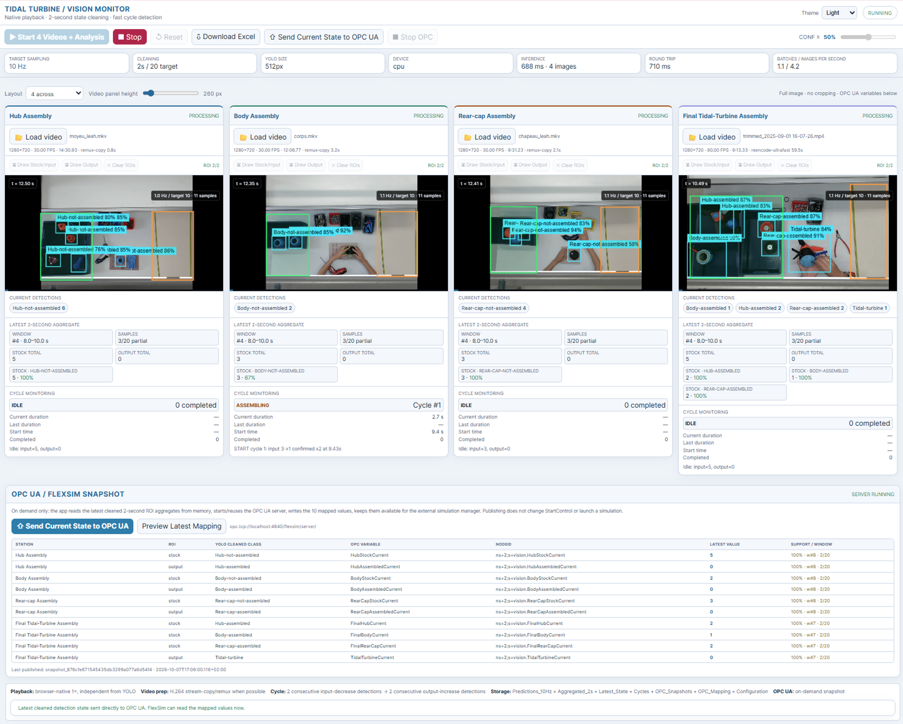

<h1 align="center">Vision2Twin</h1>

<h3 align="center">
Computer Vision–Driven Digital Twin for Manufacturing
</h3>

<p align="center">
Technical repository of the PhD thesis project integrating computer vision,
data processing, Digital Twin technologies, and a web-based monitoring application.
</p>

<p align="center">
  
  
  
  
</p>

## Overview

This repository accompanies the PhD thesis prepared by **Nessrine FARHAT**, entitled:

> **Vision-Based Digital Twins for Manufacturing Systems: From Industrial Visual Perception to Simulation and Decision Support**

It provides the technical material developed as part of the thesis, including computer vision pipelines, dataset preparation, model training and evaluation, Digital Twin integration, and the web-based monitoring application.

The proposed framework aims to connect industrial visual perception with Digital Twin technologies in order to support manufacturing monitoring, simulation, and decision-making.

## System Architecture

The Vision2Twin framework establishes a connection between the physical manufacturing environment and its Digital Twin representation.

Visual data acquired from the production system are processed using computer vision models to extract production information. These variables are then communicated to the Digital Twin through OPC UA, where they can support simulation, monitoring, and decision support.

<p align="center">
  
</p>

<p align="center">
  <em>Overall architecture of the Vision2Twin framework.</em>
</p>

## Key Contributions

This repository provides the main technical components developed within the thesis, including:

- Computer vision pipelines for industrial visual perception.
- Synthetic, controlled, and spontaneous real-world data preparation.
- Training and evaluation of YOLO and YOLO-World models.
- Detection of assembly states and production-related objects.
- Extraction of manufacturing information such as work-in-progress, operating times, and production-order progress.
- Communication of production variables through OPC UA.
- Integration with a FlexSim-based Digital Twin.
- A web-based monitoring application for visualization and interaction with the manufacturing process.
## Dataset

The computer vision models developed within Vision2Twin rely on visual data representing the different stages and components of the tidal-turbine assembly process.

Three complementary sources of data are considered:

### Synthetic Data

Synthetic images are generated from virtual representations of the tidal-turbine components and assembly configurations.

They provide large-scale annotated data and enable controlled variation of viewpoints, configurations, object states, and visual conditions.

### Controlled Real-World Data

Controlled data are acquired under experimental conditions in which objects, viewpoints, and assembly configurations can be deliberately varied.

These data reduce the gap between fully synthetic environments and actual production conditions.

### Spontaneous Real-World Data

Spontaneous data are collected directly from the manufacturing environment during real production activities.

They represent the visual variability encountered during actual deployment and are used to assess and improve the ability of the computer vision models to generalize to real industrial conditions.

The associated dataset is intended to be made available separately.

> > Dataset: [TTA: A Tidal Turbine Assembly Dataset for Industrial Computer Vision and Digital Twins](ZENODO_LINK)

## Models

Vision2Twin uses object detection models from the YOLO family, with particular emphasis on YOLO-World for industrial visual perception.

### Base Models

The experiments use pretrained YOLO and YOLO-World checkpoints as initialization for task-specific fine-tuning.

### Fine-Tuned Models

Different model configurations are trained using:

- Synthetic data.
- Controlled real-world data.
- Combined synthetic and controlled data.
- Mixed-domain datasets.
- Spontaneous real-world production data.

The repository contains the scripts used to reproduce the principal training and evaluation configurations.

### Deployment Model

The final deployment model is used by the Vision2Twin web application to process workstation video streams and generate the production information required by the Digital Twin.

Model files are stored under:

```text
models/
├── finetuned/
└── deployment/

## Installation

Clone the repository:

```bash
git clone https://github.com/FarhatNessrine/Vision2Twin.git
cd Vision2Twin
```

Create a Python virtual environment:

```bash
python -m venv .venv
```

Activate the virtual environment.

### Windows

```bash
.venv\Scripts\activate
```

### Linux / macOS

```bash
source .venv/bin/activate
```

Upgrade `pip`:

```bash
python -m pip install --upgrade pip
```

Install the required Python dependencies:

```bash
pip install -r requirements.txt
```

Verify that the main dependencies are correctly installed:

```bash
python -c "import torch; import ultralytics; print('PyTorch:', torch.__version__); print('CUDA available:', torch.cuda.is_available()); print('Ultralytics installed successfully')"
```

If a CUDA-compatible GPU is available, PyTorch should report:

```text
CUDA available: True
```

The repository contains several components that can be used independently.

### Run Computer Vision Inference

Inference scripts are available in:

```text
scripts/inference/
```

Example:

```bash
python scripts/inference/run_inference.py --help
```

For YOLO-World text-prompt inference:

```bash
python scripts/inference/run_yoloworld_text_prompts.py --help
```

### Train a Model

Training scripts are available in:

```text
scripts/training/
```

For example:

```bash
python scripts/training/finetune_yolo.py --help
```

or:

```bash
python scripts/training/finetune_yoloworld.py --help
```

### Evaluate a Model

Evaluation scripts are available in:

```text
scripts/evaluation/
```

Example:

```bash
python scripts/evaluation/evaluate_model.py --help
```

### Run the Vision2Twin Web Application

Move to the web application directory:

```bash
cd webapp
```

Run the Flask application:

```bash
python app.py
```

Then open the local address displayed in the terminal, typically:

```text
http://127.0.0.1:5000
```
